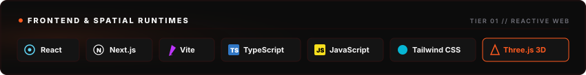
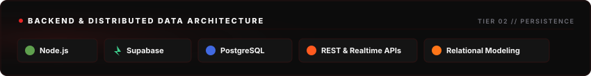
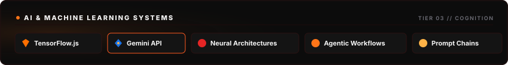
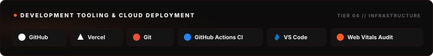
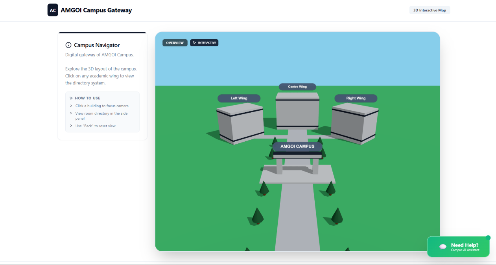
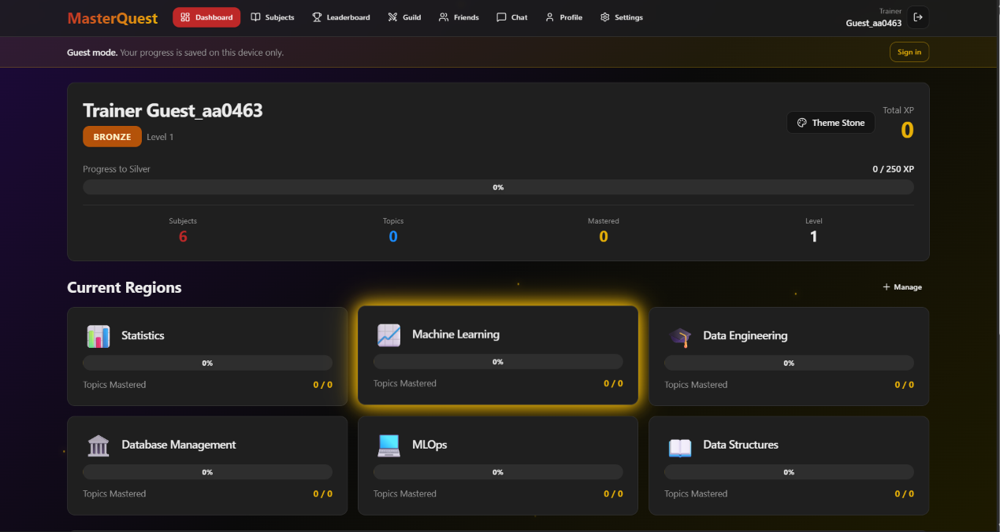
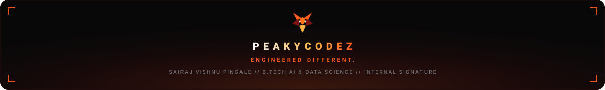

<div align="center">

<a id="signature-hero"></a>


<br/><br/>

<!-- NAVIGATION MATRIX -->
<table>
  <tr>
    <td align="center"><b><a href="#the-engineer">01. THE ENGINEER</a></b></td>
    <td align="center"><b><a href="#current-operations">02. OPERATIONS</a></b></td>
    <td align="center"><b><a href="#engineering-arsenal">03. ARSENAL</a></b></td>
    <td align="center"><b><a href="#project-vault">04. PROJECT VAULT</a></b></td>
  </tr>
  <tr>
    <td align="center"><b><a href="#performance-core">05. PERFORMANCE</a></b></td>
    <td align="center"><b><a href="#contribution-matrix">06. CONTRIBUTIONS</a></b></td>
    <td align="center"><b><a href="#beyond-the-code">07. PHILOSOPHY</a></b></td>
    <td align="center"><b><a href="#establish-connection">08. CONNECT</a></b></td>
  </tr>
</table>


</div>

<br/>

<a id="the-engineer"></a>
## 01 // THE ENGINEER

```text
┌── IDENTITY PROTOCOL ────────────────────────────────────────────────────────┐
│ NAME:       Sairaj Vishnu Pingale                                           │
│ MONIKER:    PeakyCodez                                                      │
│ SPECIALTY:  Full-Stack AI Development & Spatial Web Experiences             │
│ ACADEMICS:  B.Tech in Artificial Intelligence & Data Science                │
│ SIGNATURE:  ENGINEERED DIFFERENT.                                           │
└─────────────────────────────────────────────────────────────────────────────┘
```

> Modern software engineering requires uncompromising craft. I build high-velocity digital products where artificial intelligence, real-time 3D spatial rendering, and resilient full-stack architectures converge. Every system is conceived with structural discipline, razor-sharp performance, and intentional visual direction.

<br/>

<div align="center">

</div>

<br/>

<a id="current-operations"></a>
## 02 // CURRENT OPERATIONS

<table width="100%">
  <tr>
    <td width="33%" valign="top">
      <h4>⚡ BUILDING</h4>
      <ul>
        <li><b>Generative AI Engines</b>: Production systems converting complex prompts into functional digital interfaces.</li>
        <li><b>Spatial 3D Environments</b>: Interactive web experiences powered by Three.js and WebGL.</li>
        <li><b>Knowledge Graph Networks</b>: Personal intelligence hubs connecting unstructured data.</li>
      </ul>
    </td>
    <td width="33%" valign="top">
      <h4>🔬 EXPLORING</h4>
      <ul>
        <li><b>Autonomous AI Pipelines</b>: Multi-agent execution chains and structured reasoning protocols.</li>
        <li><b>Low-Latency Graphics</b>: Optimization of real-time shaders, 3D asset compression, and browser frame rates.</li>
        <li><b>State Machine Logic</b>: Deterministic event handling for automation engines.</li>
      </ul>
    </td>
    <td width="33%" valign="top">
      <h4>🎯 MASTERING</h4>
      <ul>
        <li><b>Full-Stack Orchestration</b>: Next.js App Router, TypeScript safety, and serverless data layers.</li>
        <li><b>Relational Modeling</b>: Scalable PostgreSQL schemas with Supabase edge integrations.</li>
        <li><b>Fluid UI Engineering</b>: High-contrast, micro-animated responsive user experiences.</li>
      </ul>
    </td>
  </tr>
</table>

<br/>

<div align="center">

</div>

<br/>

<a id="engineering-arsenal"></a>
## 03 // ENGINEERING ARSENAL

<div align="center">

<a href="https://react.dev/" target="_blank">
  
</a>

<br/><br/>

<a href="https://nodejs.org/" target="_blank">
  
</a>

<br/><br/>

<a href="https://ai.google.dev/" target="_blank">
  
</a>

<br/><br/>

<a href="https://vercel.com/" target="_blank">
  
</a>

</div>

<br/>

<div align="center">

</div>

<br/>

<a id="project-vault"></a>
## 04 // PROJECT VAULT

Six production artifacts architected with distinctive technical focus.

<br/>

<!-- PROJECT 01: UNSEEN HERITAGE -->
### 01 // UNSEEN HERITAGE

<div align="center">

</div>

**Cultural Exploration Platform with Real-Time 3D Spatial Environments**

An India heritage exploration and learning platform featuring interactive cultural experiences and 3D environments. Built to preserve, visualize, and interact with cultural history through immersive web graphics.

- **Domain**: Spatial Web · Cultural Heritage · 3D Interactive Graphics
- **Core Technologies**: `Three.js` `React` `WebGL` `Vite` `Tailwind CSS`
- **Architecture Highlights**:
  - WebGL viewport delivering 60 FPS real-time heritage asset rendering.
  - Interactive spatial camera paths providing free-look cultural topography exploration.
  - Responsive spatial audio and narrative checkpoint choreography.

<details>
<summary><b>System Architecture &amp; Engineering Specifications</b></summary>
<br/>

```text
[Browser Viewport] ──> [Three.js Scene Graph] ──> [GLTF / Custom Mesh Buffer]
                             │
                             ├──> [Dynamic Camera Controller]
                             └──> [Custom Shader Shading Pass]
```
- Custom mesh loader handling compressed 3D assets to minimize initial page payload.
- Touch and mouse orbit controls calibrated for fluid spatial navigation.
- Accessible documentation indexing historical artifacts with contextual metadata.
</details>

<br/>

<!-- PROJECT 02: BLACKBOOK -->
### 02 // BLACKBOOK

<div align="center">

</div>

**AI-Powered Knowledge Management &amp; Information Graph Core**

An AI-powered personal knowledge management platform focused on organizing and connecting information. Transforms fragmented research, notes, and technical references into a unified intelligence graph.

- **Domain**: Knowledge Engineering · AI Information Management · Graph Systems
- **Core Technologies**: `TypeScript` `Next.js` `Node.js` `Supabase` `PostgreSQL`
- **Architecture Highlights**:
  - Relational graph connecting disparate information clusters.
  - High-velocity search indexing across notes, documentation, and external references.
  - Automated categorization schema maintaining knowledge hierarchy without manual sorting overhead.

<details>
<summary><b>System Architecture &amp; Engineering Specifications</b></summary>
<br/>

```text
[Knowledge Entry] ──> [Text Normalization Pipeline] ──> [PostgreSQL Relational Core]
                                │
                                └──> [Graph Association Indexer] ──> [Interconnected Graph]
```
- Structured data schema with foreign-key relationships preserving contextual linkage between notes.
- Incremental static revalidation ensuring instant note lookup and low latency updates.
- End-to-end type safety enforced via TypeScript and strict schema validations.
</details>

<br/>

<!-- PROJECT 03: PEAK AI -->
### 03 // PEAK AI

<div align="center">

</div>

**Autonomous AI-Powered Website Generation Platform**

An AI-powered website generation product designed to synthesize responsive, production-ready web interfaces from natural language prompts.

- **Domain**: Generative Web Architecture · Autonomous Systems · UI Synthesis
- **Core Technologies**: `React` `Next.js` `TypeScript` `Gemini API` `Tailwind CSS`
- **Architecture Highlights**:
  - Prompt-to-component synthesis engine generating semantic HTML and Tailwind CSS structures.
  - Real-time preview canvas rendering synthesized code instantaneously.
  - Component library mapping ensuring visual consistency across generated sections.

<details>
<summary><b>System Architecture &amp; Engineering Specifications</b></summary>
<br/>

```text
[User Specification] ──> [Gemini API Prompt Chain] ──> [AST Token Parser]
                                                              │
                                                              └──> [Live Preview Sandbox]
```
- Streaming token parser delivering incremental UI rendering as code generation completes.
- Clean code extraction producing exportable, production-ready React component code.
- Strict token sanitization preventing malformed layouts or broken DOM trees.
</details>

<br/>

<!-- PROJECT 04: CAMPUSWAY -->
### 04 // CAMPUSWAY

<div align="center">

</div>

**3D Interactive Campus Navigation Experience for AMGOI**

A 3D interactive campus navigation experience for Ashokrao Mane Group of Institutions. Delivers an interactive spatial digital twin of the institution's topography, academic blocks, and infrastructure.

- **Domain**: Spatial Navigation · Campus Digital Twin · 3D Web Mapping
- **Core Technologies**: `Three.js` `JavaScript` `WebGL` `HTML5/CSS3`
- **Architecture Highlights**:
  - High-fidelity 3D model mapping campus buildings, pathways, and points of interest.
  - Spatial route visualization assisting visitors and students with building identification.
  - Optimized asset pipeline ensuring rapid loading on mobile networks.

<details>
<summary><b>System Architecture &amp; Engineering Specifications</b></summary>
<br/>

```text
[Topographical Assets] ──> [Three.js Scene Matrix] ──> [Raycaster Navigation Ray]
                                   │
                                   └──> [HUD Landmark Overlay]
```
- Raycasting collision detection enabling interactive clicking on campus buildings to display department data.
- Optimized lighting configuration using baked ambient maps for high graphical fidelity with low battery drain.
- Intuitive viewport controls calibrated for both touch devices and desktop precision.
</details>

<br/>

<!-- PROJECT 05: HIRESENSE AI -->
### 05 // HIRESENSE AI

<div align="center">

</div>

**AI-Powered Recruitment &amp; Technical Interview Assessment Engine**

An AI-powered recruitment and interview platform engineered to streamline candidate evaluation, automated interview conduction, and technical scoring.

- **Domain**: Recruitment Intelligence · Technical Evaluation · AI Scoring Core
- **Core Technologies**: `React` `Node.js` `Gemini API` `TypeScript` `Supabase`
- **Architecture Highlights**:
  - Objective technical interview question generation and response evaluation.
  - Multi-dimensional assessment scoring technical accuracy, problem-solving, and communication.
  - Candidate telemetry dashboard visualizing performance indicators and strengths.

<details>
<summary><b>System Architecture &amp; Engineering Specifications</b></summary>
<br/>

```text
[Interview Submission] ──> [Evaluation Scoring Core] ──> [Multi-Metric Telemetry]
                                    │
                                    └──> [Recruiter Analytical Summary]
```
- Contextual evaluation rubric assessing responses against benchmark engineering standards.
- Automated transcription and response classification powered by Gemini API.
- Secure database storage ensuring confidential candidate assessment records.
</details>

<br/>

<!-- PROJECT 06: MASTERQUEST -->
### 06 // MASTERQUEST

<div align="center">

</div>

**Pokémon-Inspired RPG Logic &amp; Automation Project**

A Pokémon-inspired RPG and automation project exploring deterministic battle mechanics, entity state progression, and programmatic gameplay automation.

- **Domain**: Game Engineering · Turn-Based State Machines · Runtime Automation
- **Core Technologies**: `JavaScript` `Node.js` `State Machine Architecture`
- **Architecture Highlights**:
  - Turn-based battle calculation engine factoring element types, stats, and random critical probabilities.
  - Programmatic automation routines orchestrating character movement, progression loops, and resource gathering.
  - Independent codebase architecture separated from other gaming initiatives.

<details>
<summary><b>System Architecture &amp; Engineering Specifications</b></summary>
<br/>

```text
[Game State Dispatcher] ──> [Deterministic Turn Engine] ──> [Battle Outcome Resolver]
                                    │
                                    └──> [Automation Script Controller]
```
- Finite state machine managing distinct gameplay states: Roaming, Encounter, Turn Calculation, and Victory.
- Clean algorithmic battle damage formulas maintaining mathematical fidelity.
- Lightweight Node.js automation framework enabling deterministic gameplay simulations.
</details>

<br/>

<div align="center">

</div>

<br/>

<a id="performance-core"></a>
## 05 // PERFORMANCE CORE

<div align="center">

<table width="100%">
  <tr>
    <td width="50%" align="center">
    </td>
    <td width="50%" align="center">
    </td>
  </tr>
</table>

<br/>


</div>

<br/>

<div align="center">

</div>

<br/>

<a id="contribution-matrix"></a>
## 06 // CONTRIBUTION MATRIX

<div align="center">


</div>

<br/>

<div align="center">

</div>

<br/>

<a id="beyond-the-code"></a>
## 07 // BEYOND THE CODE

```text
┌── CORE PRINCIPLES ──────────────────────────────────────────────────────────┐
│ 01. ZERO COMPROMISE ON LATENCY    Target 60 FPS and sub-100ms response.     │
│ 02. INTENTIONAL AESTHETIC FORM    Engineering beauty and utility as one.    │
│ 03. FULL-STACK AUTONOMY           Ownership from database schema to UI.     │
│ 04. RELENTLESS ITERATION          Code is never static; refine daily.       │
└─────────────────────────────────────────────────────────────────────────────┘
```

- **Architectural Philosophy**: Software is an art form driven by scientific precision. I eliminate bloat, optimize every network roundtrip, and ensure that every user interaction feels instantaneous, visceral, and crafted.
- **Academic Foundation**: Studying B.Tech in Artificial Intelligence & Data Science provides deep exposure to linear algebra, neural structures, and algorithmic complexity, forming the computational bedrock for all practical applications.
- **Long-Term Vision**: Building independent, enduring software products that merge autonomous intelligence with immersive real-time computing.

<br/>

<div align="center">

</div>

<br/>

<a id="establish-connection"></a>
## 08 // ESTABLISH CONNECTION

Direct channels to explore codebases, collaborate on advanced projects, and connect professionally.

<br/>

<div align="center">

<a href="https://github.com/PeakyCodez" target="_blank">
  
</a>
&nbsp;&nbsp;&nbsp;&nbsp;
<a href="https://linkedin.com/in/sairaj-pingale" target="_blank">
  
</a>

<br/><br/>

</div>

<br/>

<div align="center">

<a id="signature-footer"></a>


<br/><br/>

<sub>PEAKYCODEZ &copy; 2026 SAIRAJ VISHNU PINGALE &middot; ALL RIGHTS RESERVED</sub>

</div>
